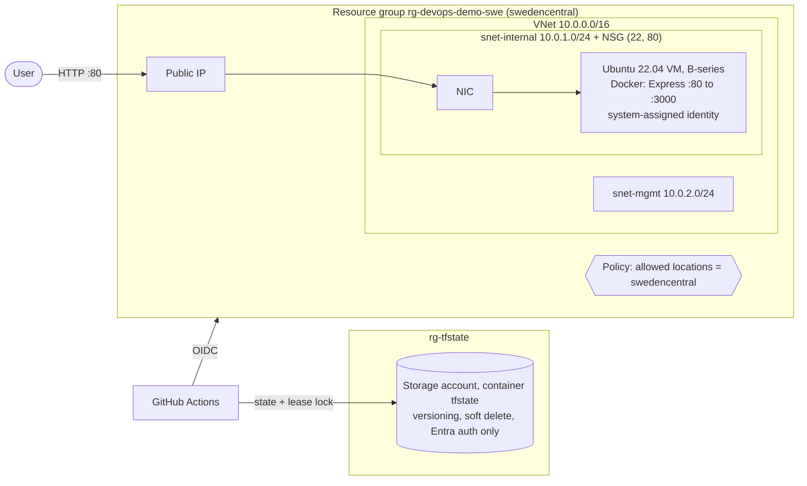
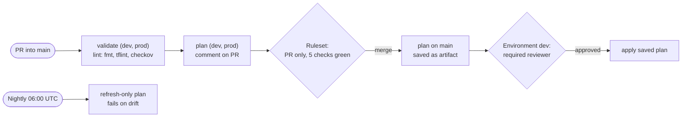

# azure-express-terraform

A small Express app running in Docker on an Azure VM. All infrastructure is defined in Terraform and deployed by GitHub Actions through a reviewed, approval-gated pipeline.

I built this as a hands-on learning project for Azure and Terraform. The interesting parts are the decisions around the infrastructure and the pipeline, not the app itself.

## Architecture





## Repository layout

| Path | Purpose |
|---|---|
| `modules/network` | VNet, two subnets (`cidrsubnet`), NSG with rules from a map (`dynamic` + `for_each`), subnet association |
| `modules/vm` | Public IP, NIC, Ubuntu VM with cloud-init that builds and runs the Express container |
| `envs/dev` | Dev root: uses the local modules, adds the allowed-locations policy |
| `envs/prod` | Prod root: uses the modules pinned to git tag `v1.0.0`, own state and address space (`10.1.0.0/16`) |
| `labs/compute` | Learning lab: VM scale set behind a load balancer with autoscale, App Service, Log Analytics and alerts. Not part of the pipeline |
| `.github/workflows` | `deploy.yml` (validate, lint, plan, apply) and `drift.yml` (nightly drift check) |

## Decisions and why

**State**
- Remote state in a separate resource group (`rg-tfstate`), one key per root, so destroying an environment never touches its state.
- Blob versioning and soft delete, so a corrupted or deleted state can be restored. Locking uses the blob lease.
- Entra ID auth only (`use_azuread_auth = true`), shared keys disabled and rotated. Access is a data-plane role (Storage Blob Data Contributor) per identity, not an account key anyone can copy.

**Code structure**
- Reusable modules plus one root per environment. Prod consumes a tagged module version, so a module change reaches prod only when the tag is bumped on purpose.
- `for_each` over maps instead of `count`, so removing an item doesn't shift indexes and recreate unrelated resources.
- `moved` blocks for the refactor into modules: addresses changed, resources stayed.
- Guardrails at two levels: variable `validation` and a `precondition` (B-series sizes only) give fast feedback in plan; an Azure Policy assignment enforces the allowed region server-side for every tool.

**Pipeline**
- OIDC federation instead of a client secret: no long-lived cloud credentials in GitHub. Separate federated credentials for `pull_request`, `main` and `environment:dev`.
- Plan once, apply that exact plan: `plan -out=tfplan` on main is uploaded as an artifact and applied after approval. Terraform is pinned to the same version in every job, which a saved plan requires.
- Two gates: a ruleset on `main` (PR only, five required checks), and a GitHub environment with a required reviewer before apply. `concurrency` prevents two applies at once.
- Least privilege per job: `id-token: write` only where Azure is needed, `pull-requests: write` only for the plan comment.
- Nightly drift detection with `plan -refresh-only -detailed-exitcode -lock=false`, so changes made outside Terraform are reported without blocking real applies.

**Security**
- tflint (azurerm ruleset) and checkov run on every PR. Accepted findings are suppressed in code with a reason, not globally.
- No secrets in state: the SSH key is generated outside Terraform and only the public half is passed in. Secret values belong in Key Vault, created outside Terraform, never as resource attributes.
- The VM has a system-assigned managed identity, so code on it can call Azure without stored credentials.

## How to run it

Prerequisites:
- Azure CLI, logged in (`az login`) to the target subscription
- Terraform 1.16 or newer
- Storage Blob Data Contributor on the state storage account
- An SSH key pair; the public key is passed as a variable

```bash
export TF_VAR_ssh_public_key="$(cat ~/.ssh/id_ed25519.pub)"
terraform -chdir=envs/dev init
terraform -chdir=envs/dev plan
terraform -chdir=envs/dev apply
```

The app answers on `http://<vm_public_ip>/` (output `vm_public_ip`). Clean up with:

```bash
terraform -chdir=envs/dev destroy
```

Environments are destroyed between sessions to keep costs near zero; only the state storage account stays.
